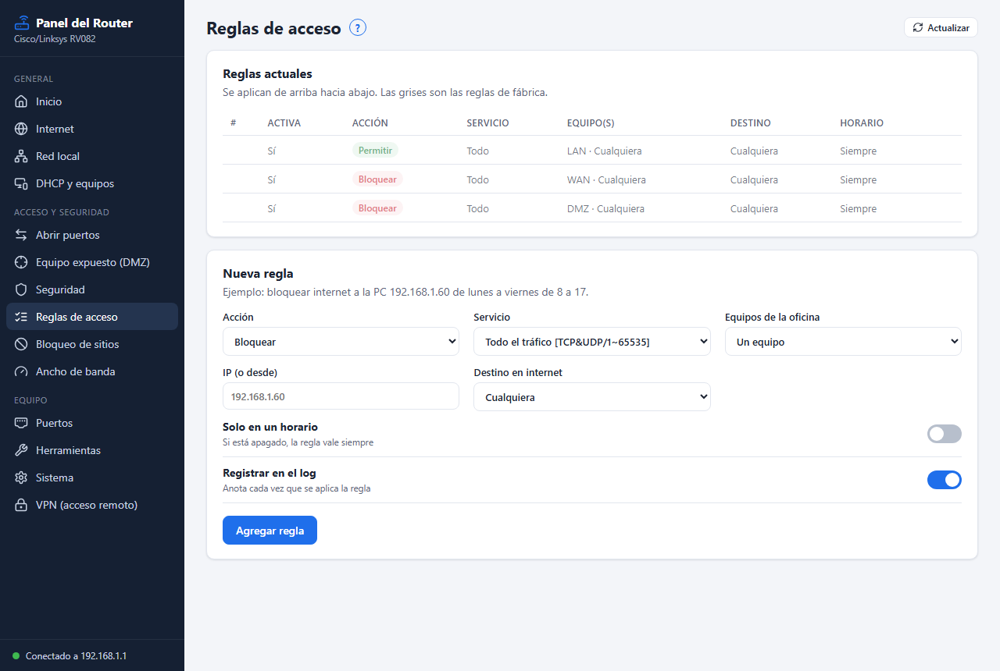
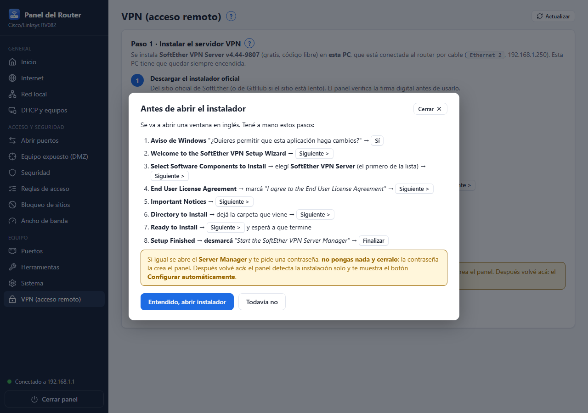

<p align="center"></p>

<h1 align="center">Panel del Router</h1>

<p align="center">Interfaz en español, simple y moderna, para configurar el router <b>Cisco/Linksys RV082</b> (firmware 2.0.0.19),<br>
con <b>VPN de acceso remoto gratuita</b> que no necesita abrir puertos ni comprar un dominio.</p>

<p align="center"></p>

## Para qué sirve

La interfaz original del RV082 está en inglés, es de 2009 y tiene decenas de opciones que una oficina no usa.
Este programa hace de **intermediario**: muestra solo lo útil, en español, con un botón **?** de ayuda en cada sección,
y traduce cada acción a los formularios del router.

| Sección | Qué permite |
|---|---|
| Inicio | Estado de internet, IPs, puertos con cable, firmware |
| Internet | Automática (DHCP), IP fija o PPPoE, DNS, MTU |
| Red local | IP y máscara del router |
| DHCP y equipos | Rango, reservas de IP fija por equipo, equipos conectados |
| Abrir puertos | Reenvío por servicio o número de puerto (crea el servicio solo), UPnP |
| Equipo expuesto | DMZ host |
| Seguridad | SPI, DoS, bloqueo de pedidos desde internet, administración remota |
| Reglas de acceso | Permitir/bloquear por equipo, servicio, horario y días |
| Bloqueo de sitios | Dominios y palabras, con horario |
| Ancho de banda | Velocidad de la conexión y mínimos/máximos por equipo |
| Puertos | Encender/apagar puertos, prioridad |
| Herramientas | Ping, DNS y registro del router |
| Sistema | Contraseña, hora, respaldo, reinicio, restaurar de fábrica (con respaldo previo y doble confirmación) |
| **VPN** | Instala, configura y desinstala SoftEther VPN Server con VPN Azure (el instalador queda guardado) |

Se quitaron a propósito: VPN router a router y router a PC (IPsec/PPTP/QuickVPN), ProtectLink, DDNS, Dual-WAN, SNMP
y actualizar firmware.

## VPN sin abrir puertos



1. El panel descarga **SoftEther VPN Server** (código libre) y **verifica su firma digital**.
2. Muestra paso a paso qué tocar en el instalador.
3. Con un botón configura **VPN Azure** (dirección gratuita `nombre.vpnazure.net`, funciona aunque el router esté detrás de otro módem),
   la VPN **SSTP** de Windows y el puente a la red del router.
4. Por cada usuario genera un archivo `.bat`: en la PC de afuera (Windows 10) un doble clic crea la conexión, sin instalar nada.

<br clear="right">

## Descargar y usar

En [**Releases**](../../releases) hay dos ejecutables (no necesitan Python):

- `PanelRouter-32bits.exe` → funciona en Windows de **32 y 64 bits** (recomendado)
- `PanelRouter-64bits.exe` → solo Windows de 64 bits

La PC tiene que estar conectada por cable a un puerto LAN del router. Al abrirlo aparece una ventana propia y un
**ícono junto al reloj**: clic derecho → **Cerrar todo** para salir (o el botón *Cerrar panel* dentro de la ventana).
La ventana usa tu navegador predeterminado si es Chrome, Edge, Brave, Vivaldi, Opera o Yandex (o el primero que
encuentre; con Firefox abre una instancia aparte), siempre con un perfil propio para no tocar tus pestañas.

### Desde el código

```
cd app
python servidor.py            # abre la ventana y el ícono de bandeja
python servidor.py --sin-ventana --puerto=8096
```

Solo usa la biblioteca estándar de Python (3.10+). Para compilar los `.exe`:
`herramientas\compilar-32bits.ps1` (descarga un Python oficial de 32 bits portable, verifica su firma) y
`herramientas\compilar-64bits.ps1`.

## Cómo se aseguró que no rompe la configuración

El firmware tiene muchas trampas: campos ocultos con valores basura que el JavaScript corrige al cargar, bloques
comentados con campos duplicados, listas que se envían invertidas y que se **borran** si faltan, servicios con IDs
negativos, etc. Por eso:

- `app/pruebas/validar.py` ejecuta cada operación en la página original del router con un navegador real,
  **intercepta y cancela** el envío, y lo compara campo por campo con el que genera el programa
  (24 de 24 operaciones idénticas).
- Las operaciones con listas se probaron en un router real deshaciendo cada cambio.
- Antes de cada cambio se guarda una copia de los valores anteriores (`app/respaldos/`).

La documentación técnica de cada página del router está en [`docs/especificaciones`](docs/especificaciones).

## Estructura

```
app/servidor.py        servidor local (127.0.0.1:8095) + API JSON + ventana + bandeja
app/rv082/cliente.py   lectura de formularios y envío idéntico al navegador
app/rv082/funciones.py estado, internet, LAN, DHCP, puertos, diagnóstico, sistema
app/rv082/seguridad.py reenvío, UPnP, DMZ, firewall, reglas, bloqueo de sitios
app/rv082/ancho.py     control de ancho de banda
app/rv082/vpn.py       SoftEther: descarga + firma, vpncmd, usuarios, .bat para clientes
app/rv082/bandeja.py   ícono de bandeja con ctypes (32 y 64 bits, sin dependencias)
app/web/               interfaz (HTML, CSS, JS)
app/pruebas/           banco de pruebas contra el navegador real
```

## Créditos y licencia

- Código bajo licencia [MIT](LICENSE).
- Íconos: [Lucide](https://lucide.dev) (ISC), ver `app/web/iconos/LICENCIA-lucide.txt`.
- VPN: [SoftEther VPN](https://www.softether.org) (Apache 2.0) y el servicio académico gratuito VPN Azure; se descargan
  desde sus fuentes oficiales, no se incluyen en este repositorio.
- No está afiliado a Cisco, Linksys ni SoftEther.
